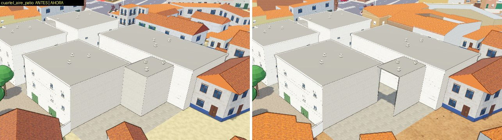
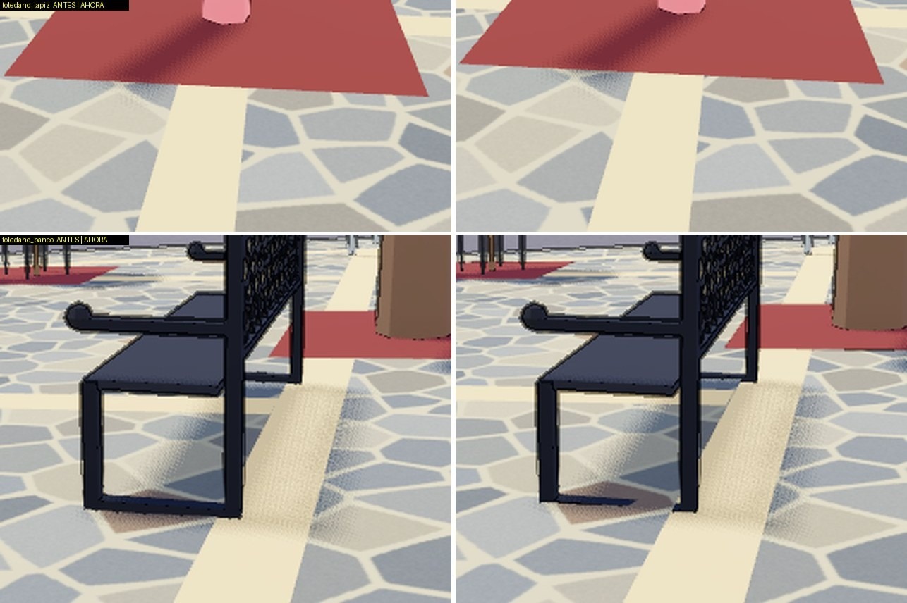
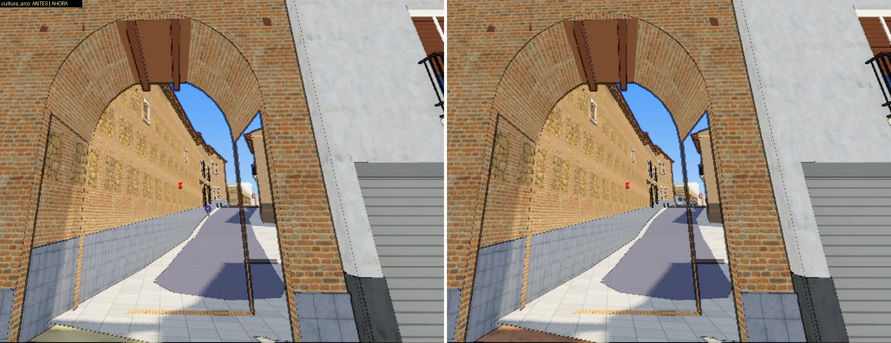
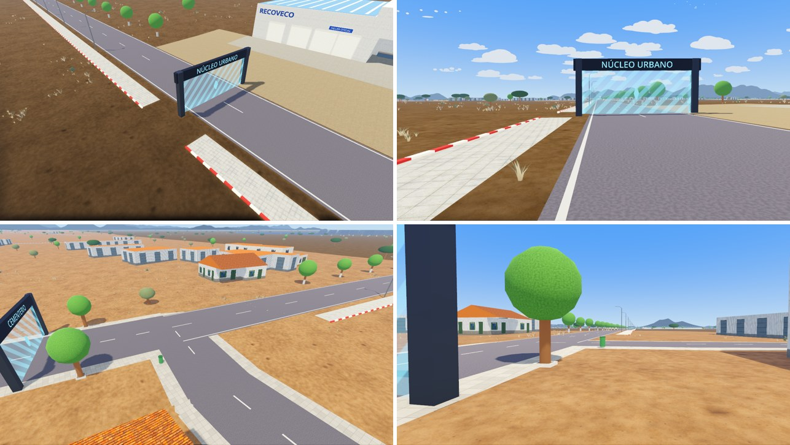
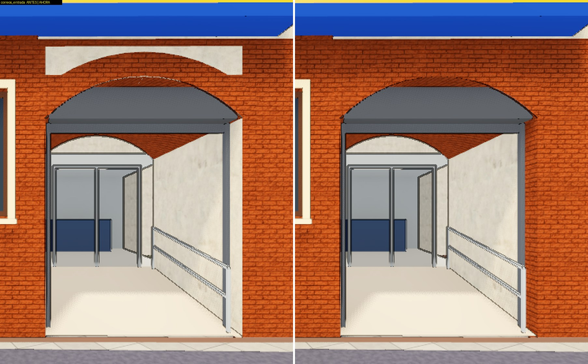

# Repaso de la campaña anti-solapes de Antigravity en los edificios hechos a mano

Pretil, 27/11/2026. Encargo de Luis: «repasa todo lo de Antigravity; propón cambios/ajustes si piensas que son necesarios».
Cuando lo escribí no había tocado ningún archivo del juego: todo lo de abajo eran propuestas. **Lo que después
aprobaste ya está hecho: mira el punto 0.**

Un «solape» es cuando dos superficies están en el mismo sitio y parpadean (Z-fighting). La campaña (versión 0.2.6) movió piezas unos centímetros en 50 edificios y en el kit común para quitarlos.

## 0. Qué se ha arreglado ya (27/11, tras tu respuesta)

Dijiste «Arregla las cuatro cosas. Que no se apilen las capas del suelo» y «Lo de la flecha arreglalo». Hecho:

- **1.1 Cuartel:** la pared ha vuelto.
- **1.2 Toledano:** el suelo es una sola lámina a la altura del bordillo, sin capas apiladas; los bancos y el lápiz ya no
  están hundidos y el dibujo del suelo es el mismo. El jugador pisa exactamente sobre ella.
- **1.3 Arco del Callejón Pando:** los pilares tienen su cara hacia el pasaje, con zócalo de granito. De paso he cerrado
  los costados de la torre de encima, que estaban huecos por arriba (no lo habías pedido).
- **1.4 Acera de la carretera del cementerio:** pasa de largo el arco «Núcleo urbano» y arranca en la acera de la última
  bocacalle del pueblo.
- **5. Flechas verdes:** las tres pruebas pulsan acción y pasan.

Fotos de antes y después: `guion/fotos/repaso_antigravity/arreglo_*.jpg`.

**Sin tocar: las rendijas del punto 2.** Las he mirado de cerca en dos sitios (`rendijas_de_cerca.jpg`) y no se nota
nada. Mi consejo: dejarlas como están.

**Una cosa aparte que salió al mirar los pies:** en las aceras normales del pueblo el personaje queda 6 cm por encima
de la acera. Es general y viene de antes (de cómo `world.gd` apila el suelo); no es de la campaña ni lo he tocado.

## En resumen

- La campaña está bien hecha en su mayor parte. En 17 sitios he comparado fotos de hoy con las de antes: en 14 no se nota diferencia, en uno mejora (Correa) y en dos empeora (cuartel y Toledano).
- **Dos cosas de la campaña se veían mal (arregladas el 27/11, punto 0):**
  1. **Cuartel: falta una pared** en el bloque de enlace de atrás.
  2. **Plazuela del Toledano: el suelo subió hasta 7 cm** y lo que hay encima (bancos, el lápiz) queda hundido en él.
- **Otras dos no son de la campaña, son mías (arregladas también).** Las vio Luis en las fotos de este repaso:
  3. **Casa Grande**: los pilares del arco del Callejón Pando están huecos y se ve a través de ellos.
  4. **Carretera del cementerio**: la acera se corta junto al arco «Núcleo urbano» y empieza suelta a la salida del pueblo.
- **Hay nueve rendijas de 1 a 4,5 cm** donde antes dos piezas se tocaban. Son cosa de mirar de cerca. Propuse cerrarlas de una pasada; después de mirar dos de cerca aconsejo dejarlas (punto 0). Sin tocar.
- **La herramienta de la campaña tiene puntos ciegos** que conviene que Antigravity y Sistemas conozcan (apartado 4).

## 1. Lo que se ve y propongo arreglar

### 1.1 Cuartel: falta la pared este del enlace de atrás (de la campaña)

- **Qué pasó**: para quitar solapes, en `cuartel.gd` se dejaron de dibujar dos lados de cada bloque de enlace. En tres de los cuatro casos ese lado queda tapado por el bloque vecino. El cuarto, el lado este del enlace de atrás, no lo tapa nada (el bloque sureste acaba 10 cm antes).
- **Propuesta**: volver a dibujar ese lado. Una línea en `_blocks()`: en `ELINK`, `1: {"skip": true}` vuelve a ser `1: plain`.
- **Efecto en la auditoría**: ninguno esperado; ese lado no coincide con ninguna otra pared.
- La entrada del cuartel (el otro enlace) está bien: fotos iguales antes y después.

### 1.2 Plazuela del Toledano: bancos y lápiz hundidos en el suelo (de la campaña)

- **Qué pasó**: el suelo son cinco capas apiladas (losas, banda, interior, tiras claras, alcorques rojos). Antes iban separadas 4 mm cada una (de 0,4 a 2 cm sobre el bordillo). La campaña las separó 1,4 cm: ahora van de 1,4 a **7 cm**. Los bancos, el lápiz, las farolas y los árboles siguen a su altura de antes, así que el suelo les tapa el pie.
- **El personaje no se ve hundido**: en dos fotos de cerca (sobre un alcorque rojo y sobre las losas) los zapatos se ven enteros. Por el código esperaba 4–7 cm de hundimiento; no he encontrado por qué no ocurre. No cambia las propuestas.
- **Propuesta (la buena)**: no apilar. Recortar cada capa por donde la tapa la de encima y ponerlas todas a la altura de antes. Así no hay dos superficies en el mismo sitio (cero solapes, ni exactos ni cercanos) y nada queda hundido. El script ya recorta polígonos para otras cosas; es cambiar la función `_floor()`.
- **Propuesta (la rápida)**: volver a las alturas de antes (4 mm). La auditoría las contará otra vez como «cercanas», no como «exactas»; a la vista no parpadeaban en mis fotos.

### 1.3 Casa Grande: los pilares del arco del Callejón Pando están huecos (mío, no de la campaña)

- **Qué pasa**: mirando el arco en diagonal se ve cielo y calle donde debería haber pilar. Está igual en la foto del 17 de noviembre, de cuando lo hice: la campaña no tocó el arco.
- **Por qué**: las paredes de dentro del paso las puse en los bordes del cuerpo del arco (a 65 cm del hueco), no en los bordes del hueco. Cada pilar queda como una caja abierta por dentro: desde un lado se ve el revés de la cara del otro lado, y el revés no se dibuja.
- **Propuesta**: en `_arco()` de `cultura.gd`, añadir las dos caras de dentro del paso en los bordes del hueco, del suelo al arranque del arco y en todo su fondo (3,4 m), de ladrillo y con el mismo zócalo gris que los pilares por fuera. Y ensanchar el tope de cada pilar hasta el borde del hueco: hoy solo cubre 30 de sus 65 cm, así que el personaje puede meterse 35 cm dentro del pilar.
- **Efecto en la auditoría**: ninguno esperado; son caras nuevas en planos donde no hay otra.

### 1.4 Carretera del cementerio: la acera se corta en el arco de zona y empieza suelta a la salida del pueblo (mío, no de la campaña)

- **Qué pasa**:
  - Junto al arco «Núcleo urbano» la acera se corta 5 m antes y vuelve 5 m después: dos tramos sueltos con 10 m de tierra en medio (fotos de arriba).
  - A la salida del pueblo, la acera del cementerio empieza suelta en la tierra, pasado el cruce con la última calle, sin tocar la acera del pueblo (fotos de abajo).
- **Por qué**:
  - En el arco de zona la corté adrede el 25 de noviembre (`_roadside()` de `cementerio.gd`) para dejar sitio a los postes. No hacía falta: el poste pisa la franja de tierra entre la calzada y la acera.
  - A la salida del pueblo la empecé a 25 m del final de la carretera del mapa, sin mirar dónde acababa la acera del pueblo.
- **Propuesta**:
  - En el arco de zona, que la acera pase de largo por fuera del poste. No cambia por dónde se puede andar: el poste ya se rodea hoy por la tierra y, por el código, el muro invisible del borde de la zona está 14 m más allá.
  - A la salida del pueblo, llevarla hasta la esquina de esa última calle y unirla allí con la acera del pueblo. El encaje exacto lo decido al verlo y te enseño la foto.
- **Efecto en la auditoría**: ninguno esperado; es alargar la misma capa.

## 2. Rendijas y piezas que se quedaron cortas (de la campaña)

Donde dos piezas se tocaban, la campaña las separó 1–4,5 cm. Las he comprobado una a una con cuentas sobre el código, no con fotos de cerca. En las fotos desde la calle de los sitios que he visto (Casa Grande, almazara, farmacia, Comunal, Tetoqa, cuartel) no se notan; el colegio viejo y la casa heredada no los he fotografiado. Mi propuesta es la misma en todas: **enterrar** (que una pieza entre 2 cm en la otra), que quita el solape sin dejar hueco. Ocho son ediciones de una o dos líneas; la de las medianeras es rehacer una función en dos archivos. Antes y después de cada sitio paso `zfight solo=<archivo>.gd` y el valor no puede subir.

| Sitio | Qué quedó | Propuesta |
| :--- | :--- | :--- |
| Casa Grande, escuela de música | Los tres escalones de la puerta del aparcamiento, a 4,5 cm de la fachada | Meterlos 3 cm en el muro |
| Almazara, recepción | Los pilares, 1,5 cm cortos bajo su viga | Pilares 2 cm dentro de la viga |
| Almazara, persianas | 1,5 cm de hueco entre persiana, jambas y dintel | Jambas y dintel montados 2 cm sobre la persiana |
| Farmacia, puerta claveteada | El dintel subió 1,5 cm: raya clara entre la hoja y el dintel | Dintel 1,5 cm dentro del hueco |
| Farmacia y Comunal, medianeras | Esquinas sin cerrar (apartado 4, punto 5) | Contorno desplazado con las esquinas unidas |
| Tetoqa, balcón | La losa, a 2,6 cm de la fachada y 1,5 cm bajo los barrotes | Losa desde 2 cm dentro del muro, a su altura |
| Cuartel, entrada | El rellano, a 1,5 cm de las paredes de su hueco | Rellano 2 cm dentro de ellas |
| Casa heredada, dormitorio | La tabla de encima del armario flota 1,5 cm | Tabla 1 cm dentro del armario |
| Colegio viejo | El fondo de la placa del nombre flota 3,5 cm del muro (a 4,6 m de alto) | Fondo desde el muro |
| Correa, pasaje de entrada | Los forros crema se quedan 1 cm cortos detrás del muro | Dejarlo: ver apartado 3 |

Sin efecto a la vista, las dejaría como están: los suelos de zaguán, porche y balcón 1,5 cm más altos (Residencia, Sopiss); la marquesina del Mercamona a 1 cm del cristal; el suelo del zaguán del Pisacastaña 5 mm más estrecho por lado; los ladrillos a sardinel de Matías Pérez.

## 3. Un cambio que se ve y me parece bien: la entrada de Correa

- **Antes** (izquierda): alrededor del pasaje asomaban dos parches de color crema sobre el ladrillo (uno encima del arco, otro a la derecha). Eran los cantos de los forros de dentro del pasaje, que llegaban justo al plano de la fachada.
- **Ahora** (derecha): los forros acaban detrás del muro y la fachada es toda de ladrillo. Queda más limpio. No he comprobado con las fotos del edificio real cuál de los dos se le parece más.
- **No propongo cambio.** Lo señalo porque, de los 17 sitios que he visto, es el único donde la campaña cambia el aspecto de una fachada ya aprobada. Si prefieres el recuadro crema de antes, se puede hacer bien: una pieza propia, 2 cm fuera del muro.

## 4. Sobre el método (para Antigravity y Sistemas)

1. **La auditoría no ve el suelo del pueblo.** `--zfight` compara piezas dentro de cada edificio hecho sobre `obra.gd`. No las compara con las capas que pone `world.gd` (sobre la misma altura del relieve: terreno −0,18; zonas −0,15 y −0,12; caminos −0,09; aceras −0,06; sendas −0,03; asfalto 0,00; marcas viales +0,02) ni con el edificio de al lado.
   - Caso: en el recinto ferial las capas se re-escalonaron dentro de ese mismo rango. La baldosa quedó a −0,058 (a 2 mm del plano de las aceras) y el hormigón del Auditorio a −0,03 (el plano de las sendas).
   - En seis vistas de hoy no se ha perdido nada ni parpadea, así que **no propongo tocarlo**; pero un «0 solapes» de la auditoría no dice nada de esto. Quien mueva capas de suelo que siguen el relieve tiene que mirar esa lista.
2. **La auditoría no ve lo que falta.** Quitar una pared baja el número de solapes aunque deje un agujero (cuartel). Tampoco ve las piezas que quedan hundidas en otra de su mismo sitio (Toledano). Bajar la cifra no basta: hay que mirar el sitio después.
3. **Separar abre rendijas; enterrar no.** Cuando dos piezas se tocan, la campaña suele separarlas 1,5 cm. Eso quita el solape pero deja una rendija por la que se ve lo de detrás. Meter una pieza 2 cm dentro de la otra quita el solape igual y no deja hueco. Propongo que la guía lo ponga como primera opción.
4. **Capas de suelo: recortar, no apilar.** Cada capa apilada pide 1,2–1,5 cm. Con cuatro o cinco, lo que está en el suelo se hunde (Toledano). Con más de dos capas, mejor recortar la de abajo.
5. **Meter las medianeras 2,5 cm lado a lado deja las esquinas sin cerrar** (`comunal.gd`, `farmacia.gd` y el `ring_walls()` del kit): en las esquinas salientes las dos paredes se cruzan y asoman 2,5 cm; en las entrantes queda una rendija. Mejor desplazar el contorno entero y unir las esquinas.
6. **Los tres ayudantes nuevos del kit no los usa nadie.** `door_frame()`, `sign_board()` y `ring_walls()` están en `obra.gd`, pero ningún edificio los llama (`comunal.gd` y `cuevas.gd` tienen su propio `_ring_walls`). No es un fallo; la guía los presenta como si ya estuvieran en uso.
7. **`max=1.0` falla de entrada en 36 sitios** (ya está en las notas de uso de la guía): la regla práctica es no subir del valor de antes.
8. **Cambiar cuántos números al azar gasta una pieza cambia todo lo que viene detrás.** En `planta_solar.gd` los bidones pasaron de sueltos al azar a un corro regular, y con eso cambian también los montones de chatarra siguientes. No es grave, pero es un aspecto ya aprobado que cambia sin querer.

## 5. Aparte de la campaña: tres pruebas de fotos caducadas

- **Qué he visto**: al sacar las fotos fallan tres comprobaciones de «entrar por la flecha verde»: en los aseos del ferial, en Correa y en el Merkocarry. No es un fallo del juego ni de la campaña.
- **Por qué**: desde el 20 de noviembre (versión 0.0.18) para entrar por una flecha verde hay que ponerse encima **y pulsar el botón de acción**. Esas pruebas siguen poniendo al personaje encima y esperando.
- **Dónde**: en `selftest.gd`, los modos de fotos `ferial`, `correos` y `merkocarry`. La batería completa no pasa por ahí.
- **Propuesta**: las arreglo yo (una línea en cada una: pulsar acción, como ya hacen el paso de la copistería en la prueba del Recress y el del silo) cuando `selftest.gd` quede libre; ahora lo tiene abierto otra sesión.

## 6. Lo que está bien

- **Visto en fotos de hoy frente a las de antes, sin diferencias que se noten**: recinto ferial (6 vistas), plaza (5), Paseo del Cristo, ermita de la Caridad, MaxiPrecio (3), Banco Cantabria (2), entrada del cuartel (2), almazara (3), Casa Grande (5), MasAhorro (6), Tetoqa (3), Universidad Comunal (6), farmacia (3), afueras y cementerio (3), Merkocarry (3).
- **Arreglos correctos, comprobados en el código** (quitaban un solape real):
  - Kebab Deluxe: el asiento rojo de los bancos ya no pisa su pie marrón.
  - Noche (interior): los paños de cal ya no pisan la banda roja.
  - MasAhorro: el tejado del anexo ya no pisa el canto de sus muros; la acera ya no pisa el bordillo.
  - Merkocarry: el suelo claro de la trastienda ya no pisa el oscuro del umbral.
  - Talleres: los muros ya no pisan el techo.
  - Cuartel: los otros tres lados quitados de los enlaces (tapados por los bloques vecinos).
  - Cementerio: las losetas se cortan ahora por las mismas facetas del relieve que el Toledano.
  - Rótulos y placas de 14 sitios: el dibujo va 1 cm más fuera de su tablero.
  - Kit: el cristal de `window()` va 2 cm metido bajo su marco (de 7 cm: no deja rendija).

## 7. Qué he mirado y qué no

- **Leído entero**: el diff de la campaña (0.2.1 → 0.2.6) del kit `obra.gd` y de los 50 edificios de la lista de Antigravity: 412 líneas nuevas y 362 quitadas.
- **Fuera de esa lista**: comprobado con git que desde la 0.2.1 no hay más cambios en mis edificios (los demás archivos cambiados son de Sistemas: coches, menús, Xandro, pantalla táctil…).
- **Fotos con ventana**: 17 sitios, comparados con las fotos de antes de la campaña (del 14 al 26 de noviembre; entre medias cambiaron también el color del suelo, los árboles y edificios vecinos, que no son de la campaña).
- **Pruebas pasadas hoy** (cada una con sus fotos): `toledano`, `plaza`, `paseo`, `caridad`, `cuartel`, `maxiprecio`, `bancosancho`, `almazara`, `cultura`, `masahorro`, `tetoqa`, `comunal`, `farmacia` y `zonas`, sin fallos; `ferial`, `correos` y `merkocarry`, con un fallo cada una, el del apartado 5.
- **No mirado en fotos** (solo en el código, cambios de 1–2 cm): Mercamona, Kebab Deluxe, Noche, IES, Calasanz, colegio viejo, Rize, Toti, Óptica, Pisacastaña, Papelería Rocas, Sopiss, Tele Dürum, Residencia, Salvador 2, Matías Pérez, puente, talleres, entrada norte, asador, aceras altas, casa heredada, molino (su foto de «antes» ya es de la campaña), planta solar (sus bidones).
- **Sin batería completa**: la pasa Sistemas cuando Texturas y yo terminemos.

## 8. Qué necesito de ti

**Respondido el 27/11:** el 1 y el 3 están hechos (punto 0); el 2 sigue abierto, sin tocar, con mi consejo de dejarlo.
Vistas las fotos de antes y después, diste el visto bueno a los arreglos el mismo 27/11 («Visto bueno»), y encargaste
a Sistemas lo de los 6 cm sobre las aceras («Si. Pásaselo»).

Lo que pregunté entonces:

1. **Lo que se ve** (apartado 1): la pared del cuartel, el suelo del Toledano, los pilares del arco y la acera de los arcos de zona. En el Toledano, ¿la buena (recortar capas) o la rápida (alturas de antes)?
2. **Las rendijas** (apartado 2): ¿las cierro todas, solo algunas, o las dejo?
3. **Las tres pruebas caducadas** (apartado 5): ¿las arreglo?
