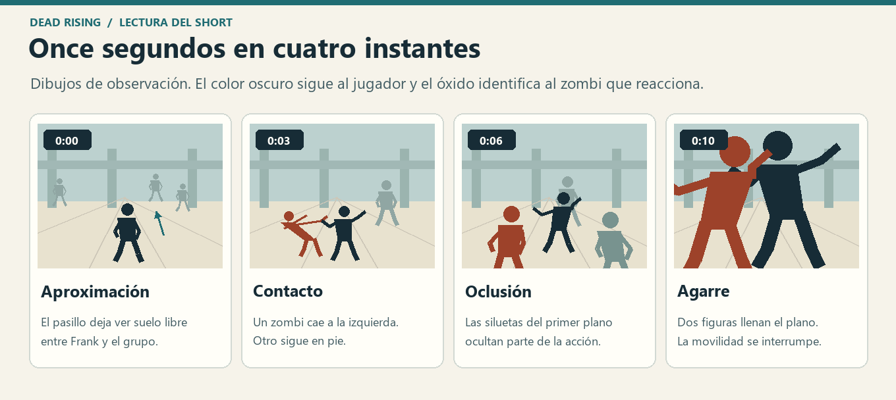
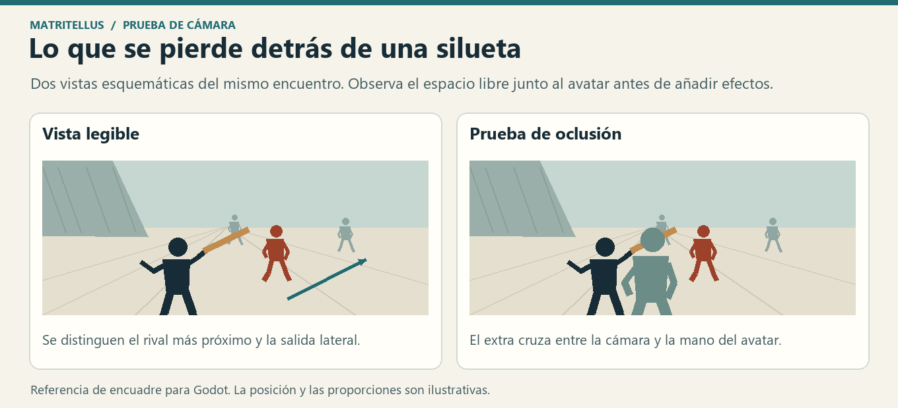
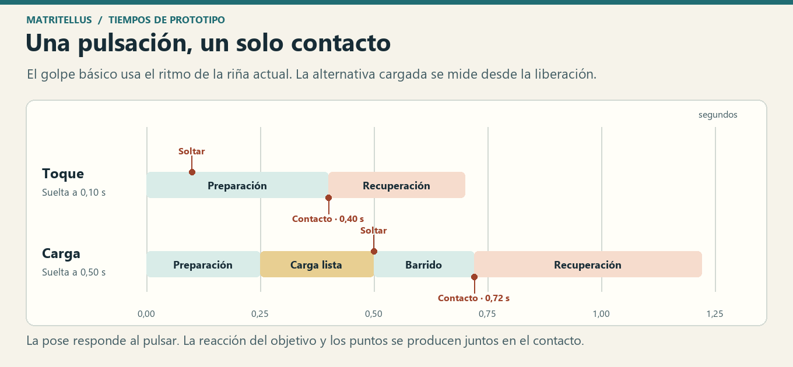
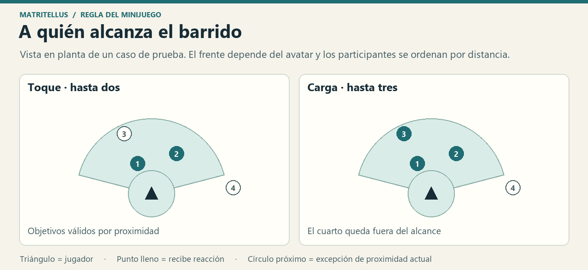

# El bate en Dead Rising

**Guía de diseño para la riña del jamón de Matritellus · Referencia de Xbox 360, 2006**

Frank se acerca a un grupo, golpea a un zombi y aún tiene a otros encima. En once segundos, el vídeo de referencia muestra por qué importa tanto poder leer el espacio que queda después de cada golpe. Para el minijuego de Henry, la decisión más interesante es **dar un toque y volver a moverse, o mantener el botón para preparar un barrido que deja al personaje ocupado más tiempo**. [Ver el Short de Vinny Bag Of Chips](https://www.youtube.com/shorts/OujAu8agqGA)

[El vídeo paso a paso](#el-vídeo-paso-a-paso) · [Controles](#controles-de-xbox-360) · [Cámara](#cámara-y-lectura-del-grupo) · [Diseño para Godot](#diseño-para-godot) · [Prompt para implementar](PROMPT.md)

## El vídeo paso a paso

*Man I love The Mall, Even With Zombies LOL*, publicado por Vinny Bag Of Chips como gameplay de Xbox 360. Las marcas corresponden al reloj del reproductor y abren la versión horizontal de la página de YouTube. El vídeo conserva su recorte vertical.

| Instante | Qué se ve | Qué llevar a una prueba de juego |
| --- | --- | --- |
| [0:00 · Aproximación](https://www.youtube.com/watch?v=OujAu8agqGA&t=0s) | Frank avanza de espaldas a cámara. Se ven suelo libre por delante, una jardinera y varias figuras a distinta distancia. | Antes del primer ataque se debe distinguir por dónde puede seguir andando el avatar. |
| [0:03 · Contacto](https://www.youtube.com/watch?v=OujAu8agqGA&t=3s) | Un zombi cae hacia la izquierda mientras otro sigue en pie a la derecha. La reacción hace legible qué figura recibió el golpe. | Con dos objetivos en pantalla, el jugador debería poder señalar cuál ha reaccionado aunque se silencie el sonido. |
| [0:06 · Multitud](https://www.youtube.com/watch?v=OujAu8agqGA&t=6s) | Varias siluetas se superponen cerca de Frank. Una figura en primer plano oculta parte del gesto. | Probar la cámara con un extra entre el avatar y la lente. La pose, el desplazamiento y el sonido ofrecen señales complementarias. |
| [0:10 · Agarre](https://www.youtube.com/watch?v=OujAu8agqGA&t=10s) | Una figura con ropa amarilla se agarra a Frank. Los dos cuerpos llenan el plano. | Un agarre o una caída necesita una señal propia de pérdida de control y otra de recuperación. |

El recorte deja fuera parte de los laterales y de la interfaz. Sirve para observar las reacciones y el cambio de escala. El mando, la duración de una pulsación y los límites de la colisión se estudian con otras fuentes. Para valorar cuánto espacio ofrece la cámara original, compáralo con una partida completa en pantalla ancha. [Partida de Xbox 360 sin comentarios](https://www.youtube.com/watch?v=7qwVME0Z0gM) · [Diagrama oficial del HUD, «Screen Layout»](https://static.capcom.com/deadrising/manuals/X360_Manual.pdf)

## Cómo funciona el combate

**El objeto cambia el verbo.** Frank recoge objetos del entorno y actúa con el que lleva seleccionado. El mismo botón puede ejecutar un ataque, usar un consumible o realizar una acción secundaria propia del objeto. El bate ofrece un golpe de barrido con un toque y una variante cargada al mantener y soltar. El tubo, por ejemplo, tiene un golpe de menor duración y se comporta de otra forma ante un grupo. La elección depende de lo que queda en el inventario y de cuánto espacio hay para completar el gesto. [Manual de Capcom, «Controls» y «Action Icons»](https://static.capcom.com/deadrising/manuals/X360_Manual.pdf) · [Prueba del bate de GameSpot](https://www.gamespot.com/articles/dead-rising-hands-on/1100-6153381/) · [Comparativa de bate y tubo en la guía del juego publicado](https://www.gamespot.com/articles/dead-rising-walkthrough/1100-6155400/)

**El barrido puede afectar a varias figuras.** El movimiento lateral del bate, la reacción de los zombis alcanzados y el espacio que se abre permiten leer el resultado. La variante cargada añade preparación y puede desplazar a los objetivos. Si el jugador calcula mal cuándo iniciarla, otros zombis siguen acercándose mientras se desarrolla el gesto. En el vídeo, los enemigos próximos siguen siendo relevantes después del primer impacto. [Guía del juego publicado](https://www.gamespot.com/articles/dead-rising-walkthrough/1100-6155400/) · [Secundaria del bate en la demostración de 2006](https://www.gamespot.com/articles/dead-rising-hands-on/1100-6153381/) · [Short, 0:03](https://www.youtube.com/watch?v=OujAu8agqGA&t=3s)

**La acción útil a veces es seguir andando.** El reloj de los casos y de los encargos sigue formando parte de la partida. Derribar enemigos puede despejar el trayecto hacia un destino o facilitar una escolta. Permanecer en el mismo lugar para seguir atacando consume tiempo y deja que otros zombis ocupen los huecos. El HUD enlaza la pelea local con la partida mediante la vida, el objeto equipado, el contador de zombis y la indicación de destino. [Manual de Capcom, «Screen Layout», «Scoops» y «Cases»](https://static.capcom.com/deadrising/manuals/X360_Manual.pdf) · [Imágenes de juego difundidas por Capcom en 2006](https://www.gamersyde.com/news_images_of_dead_rising-3222_en.html)

**El desgaste cambia la siguiente decisión.** Los objetos de mano tienen una vida útil. Al romperse el que lleva Frank, el jugador busca un sustituto o cambia de ranura. También puede lanzar el objeto equipado mediante la vista de apuntado. En ambos casos importa qué queda disponible para el siguiente encuentro. Este ciclo explica por qué una sala llena de objetos funciona a la vez como escenario y como fuente de recursos. [Entrevista al equipo de desarrollo sobre las diferencias de durabilidad](https://worthplaying.com/article/2006/1/10/interviews/30101-dead-rising-x360-developer-interview/) · [Manual de Capcom, «Aim View Mode» e «Item Window»](https://static.capcom.com/deadrising/manuals/X360_Manual.pdf)

### Qué cambia al equipar otra arma de mano

| Objeto del original | Diferencia observable en el juego | Pregunta de diseño para Godot |
| --- | --- | --- |
| Bate | El barrido tarda más que el del tubo. Puede derribar y desplazar a varios zombis en una sola acción. | ¿Se ve el mismo barrido que el juego acaba de puntuar? |
| Tubo | El gesto es más rápido y su alcance es algo mayor que el del bate en la comparación publicada. | Si dos objetos usan el mismo botón, ¿basta el ritmo de su animación para distinguirlos? |
| Katana | Encadena gestos rápidos, puede alcanzar a varios objetivos agrupados y deja una breve recuperación tras el segundo. Se desgasta pronto. | ¿Se entiende por la pose cuándo termina una secuencia y vuelve a aceptarse otra orden? |

Estas diferencias cualitativas sirven para elegir qué observar en pantalla. Las duraciones internas, los volúmenes de contacto y el número máximo de objetivos del original requerirían mediciones adicionales. [GameSpot, sección de armas cuerpo a cuerpo](https://www.gamespot.com/articles/dead-rising-walkthrough/1100-6155400/)

## Controles de Xbox 360

| Intención | Entrada del original | Efecto que puede comprobar el jugador |
| --- | --- | --- |
| Moverse / mirar | Stick izquierdo / stick derecho | Frank se desplaza por el escenario y el jugador puede cambiar el encuadre. |
| Usar el bate | Toque de **X** | Ataque primario del objeto equipado. |
| Preparar la secundaria | Mantener **X** y soltar con el bate equipado | Se prepara y ejecuta la variante cargada. Otros objetos definen su propia secundaria cuando la tienen. |
| Recoger | **B** ante el icono contextual | Se recoge el objeto que identifica el aviso. B también contextualiza otras interacciones. |
| Cambiar de objeto | **LB / RB** | Cambia la ranura activa. Conviene mirar qué objeto queda seleccionado antes de usar X. |
| Apuntar / lanzar | Mantener **RT**, orientar con el stick izquierdo y pulsar **X** | En modo de apuntado se lanza el objeto de mano. Soltar RT devuelve la vista normal. |
| Fotografiar | Mantener **LT** y pulsar **X** | Se encuadra con el stick derecho. La fotografía tiene controles y función propios. |
| Saltar | **A** en la vista normal | Permite salvar obstáculos o subir a determinados elementos del escenario. |

La tabla corresponde a la configuración de Xbox 360 del primer juego. Para ver la disposición física, abre el dibujo del mando en «Controls» y los dos diagramas de las vistas especiales en la página siguiente. [Manual oficial de Xbox 360](https://static.capcom.com/deadrising/manuals/X360_Manual.pdf) · [Guía de Xiamut para Xbox 360](https://gamefaqs.gamespot.com/xbox360/928326-dead-rising/faqs/44584)

## Cámara y lectura del grupo

La vista normal permite seguir la espalda y el gesto de Frank en primer plano, el objetivo que reacciona en el centro y los demás zombis acercándose desde el fondo o los lados. En el Short, la jardinera y las líneas del suelo permiten apreciar el avance incluso cuando dos figuras se solapan. La vista de apuntado concentra la atención en el destino del objeto. La cámara fotográfica introduce un encuadre independiente que el jugador activa deliberadamente. [Short, aproximación](https://www.youtube.com/watch?v=OujAu8agqGA&t=0s) · [Manual oficial, modos de cámara](https://static.capcom.com/deadrising/manuals/X360_Manual.pdf)

**Prueba de lectura para Matritellus.** Graba cinco segundos con cámara quieta y otros cinco mientras gira. En ambos casos, mira si se distingue el ciclo completo del bate, qué vecino ha reaccionado y qué hueco queda para moverse. Repite al lado de una fachada y con un vecino cruzando el primer plano. Si el bate desaparece contra el fondo, ajusta primero la separación de siluetas y el encuadre. Añadir vibración de cámara puede hacer más difícil reconocer el contacto.

## Diseño para Godot

### La base que ya tiene Matritellus

Se revisó la copia de Matritellus en `X:/Matritellus`, versión del juego 0.0.17. Su README identifica Godot 4.7.2. Las rutas siguientes son relativas al repositorio. Antes de implementar, conviene comprobar estos símbolos en la copia activa.

| Punto de integración | Comportamiento observado en el código |
| --- | --- |
| `godot/scripts/motin.gd` · `swing()`, `_swing_lands()`, `_hurt()` | La riña dura 60 s. Un golpe normal resuelve el contacto a los 0,40 s y acepta otro a los 0,70 s. Usa la posición y orientación del jugador en el instante del contacto. |
| Selección de vecinos | Se filtran los participantes en pie a menos de 1,9 unidades. Por debajo de 0,6 se acepta cualquier dirección. En el resto se exige un producto escalar superior a 0,25 con el frente del avatar. Se toman como máximo los dos más próximos. Es una consulta puntual por distancia y dirección. |
| Reacción y puntuación | Cada participante tiene 100 puntos de vida. Un contacto resta 25, aplica una reacción de 0,35 s y un desplazamiento. Un impacto ordinario suma 5 y el decisivo suma 10 en total. El jugador puede quedar en el suelo 1,6 s. El evento conserva su reloj. |
| `godot/scripts/chara.gd` · `swing_bat()`, `_bat_pose()` | La animación dura 0,70 s y recorre poses de la mano y del bate. Ya hay una correspondencia entre el cruce visual por delante del personaje y el instante de contacto. |
| `godot/scripts/game.gd` · `_punch()` y cámara de `motin.fighting()` | La entrada se deriva a la riña cuando está activa. El bate de exploración tiene lógica propia. La cámara de riña sigue el giro, se desplaza hacia el hombro y suaviza posición y punto de mira. |
| `controls.gd`, `touch.gd`, `loc.gd` | La acción `punch` usa clic izquierdo y X del mando. El botón táctil «Golpe» genera pulsación y liberación. El proyecto cuenta con glifos y textos en español e inglés. |
| `motin.gd` · `replay()`, `_finish()` y `selftest.gd` · `_motin_checks()` | La riña participa en el encargo de Josefa, el evento de los jueves y la repetición desde la Agenda. Esta última devuelve al jugador a su lugar y sirve para puntuar. Los Puntos Cívicos se gestionan en el cierre del evento. |

### Una primera versión jugable

**Propuesta.** Ampliar la riña de Henry con dos gestos sobre el botón «Golpe». El toque sirve para mantener el ritmo actual. Mantenerlo y soltarlo permite resolver un tercer objetivo a costa de una recuperación más larga. El bate de Josefa, el reparto, el espacio y la puntuación dan al minijuego su propia identidad. El desgaste y el lanzamiento quedan documentados como opciones para una variante posterior con objetos de recambio.

| Parámetro | Toque · base del proyecto | Carga · hipótesis de prototipo |
| --- | --- | --- |
| Selección | Soltar antes de 0,25 s desde la pulsación | A partir de 0,25 s se mantiene una pose de carga hasta soltar. Mostrar una señal discreta al cruzar el umbral. |
| Contacto | 0,40 s desde la pulsación inicial | 0,22 s después de soltar |
| Siguiente acción | A los 0,70 s desde la pulsación inicial | 0,50 s después del contacto |
| Efecto | Hasta 2 objetivos, 25 puntos de daño a cada uno | Hasta 3 objetivos, 25 puntos a cada uno. Se mantienen los valores de puntuación por resultado. |
| Respuesta al jugador | Inicio de pose al pulsar, sonido de aire y reacción al acertar | Pose sostenida y señal de carga lista. Al soltar, gesto más amplio y retorno más largo. |

**Un ejemplo de implementación.** Al pulsar, se registra el instante y comienza la preparación visual. Una liberación temprana confirma el golpe normal. Si se alcanza el umbral con el botón aún abajo, se retiene la pose. Al soltar, el gesto cargado avanza hasta su contacto. En ambos casos se resuelve la lista de participantes válidos una sola vez y se deriva el resultado a `_hurt()`. Para el corto, el reloj parte de la pulsación inicial, por lo que el tiempo pasado esperando a que se suelte el botón ya cuenta. Cuando un contacto no encuentra objetivos, suena el aire y el marcador sigue igual.

**Interrupciones.** Una caída durante la preparación o un fin de ronda antes del contacto cancelan el gesto. Una liberación posterior pierde su efecto. Procesar primero la expiración del reloj si comparte paso con el contacto. La pausa congela la simulación y al reanudar se descarta una carga si el dispositivo se soltó mientras estaba pausado. Un nuevo intento empieza con las entradas en reposo. Si se conservan temporizadores diferidos, ligarlos al intento y al ataque para que una señal vieja no puntúe en la siguiente partida.

**Cámara y controles del prototipo.** Conservar movimiento y giro independientes, usar el frente del avatar para resolver objetivos y permitir que el jugador siga mirando durante la recuperación. Ofrecer la misma semántica de pulsar, mantener y soltar con clic, mando y táctil. Si la cámara tropieza con una fachada, ajustar la distancia temporalmente y recuperarla con suavidad al salir. Colocar el aviso de carga junto al HUD actual sin tapar la mano del avatar ni al vecino que reacciona.

### Comprobaciones para darlo por jugable

| Prueba | Resultado observable |
| --- | --- |
| Soltar a 0,10 s / mantener hasta 0,50 s | Un ataque por gesto. En el primer caso el contacto ocurre cerca de 0,40 s desde la pulsación. En el segundo, cerca de 0,72 s. |
| Dos candidatos válidos, tres válidos, uno fuera del sector | Se respetan límite y distancia. Un mismo participante recibe como máximo un contacto por gesto. Girar solo la cámara no cambia el frente del avatar. |
| Golpe al aire, ordinario y decisivo | Cero, cinco o diez puntos por ese objetivo. Dos ordinarios y un golpe decisivo en el mismo barrido cargado suman 20. |
| Caída al cargar, reloj a cero o nueva partida | Se limpian pose, señal y contacto pendiente. El contador refleja únicamente los resultados de esa partida. |
| Pausa, pérdida de foco y cambio de dispositivo | Regresar al juego con el botón ya suelto deja al avatar libre. Comprobarlo con clic, mando y táctil, incluyendo arrastre de cámara con otro dedo. |
| Encargo, jueves, Agenda y exploración | El encargo avanza, se aplica la regla diaria del evento, la Agenda devuelve al lugar de origen y el bate de exploración sigue su propio recorrido. |

La prueba integrada se lanza desde la raíz con el ejecutable que especifica el README del juego. El filtro documentado es `godot --headless --path godot --fixed-fps 60 -- --selftest --motin`. Conviene acompañarlo de una partida con imagen para juzgar sincronía y oclusiones.

## Referencias de consulta

| Recurso | Qué buscar al abrirlo |
| --- | --- |
| [Short de referencia · Vinny Bag Of Chips](https://www.youtube.com/shorts/OujAu8agqGA) | Volver a los segundos 0, 3, 6 y 10. Seguir al avatar en la primera pasada y a los zombis cercanos en la segunda. |
| [Capcom · manual original de Xbox 360, PDF](https://static.capcom.com/deadrising/manuals/X360_Manual.pdf) | Buscar «Controls», «Aim View Mode», «Camera View Mode» y «Screen Layout» para contrastar mando, inventario y vistas. |
| [Gamersyde · imágenes de juego facilitadas por Capcom](https://www.gamersyde.com/news_images_of_dead_rising-3222_en.html) | Comparar la superficie que ocupa el HUD con el espacio alrededor del protagonista en una captura completa. |
| [Capcom · imágenes oficiales de la plaza, PDF](https://www.capcom.co.jp/ir/news/pdf/070110.pdf) | Observar la densidad y la separación entre personajes próximos y figuras de fondo en la captura del atrio. |
| [Partida completa de Xbox 360 sin comentarios](https://www.youtube.com/watch?v=7qwVME0Z0gM) | Contrastar el recorte del Short con la vista completa durante el primer recorrido libre por el centro comercial. |
| [Gamersyde · gameplay de Japan Expo, 2006](https://www.gamersyde.com/news_japan_expo_gameplay_of_dead_rising-3154_en.html) | Comparar la variedad de animaciones según el objeto. Es una demostración previa al lanzamiento. |
| [GameSpot · prueba jugable de junio de 2006](https://www.gamespot.com/articles/dead-rising-hands-on/1100-6153381/) | Descripción de la diferencia entre uso normal y carga del bate en la demo. |
| [GameSpot · guía del juego publicado](https://www.gamespot.com/articles/dead-rising-walkthrough/1100-6155400/) | Buscar «Baseball Bat» y «Lead Pipe» para comparar duración del gesto, alcance relativo y reacción de varios objetivos. |

Las cuatro láminas locales son dibujos explicativos originales. Los tiempos del prototipo, sus límites de objetivos y sus criterios de puntuación corresponden a Matritellus. Las fichas enlazadas permiten consultar el material de Dead Rising en sus fuentes.
