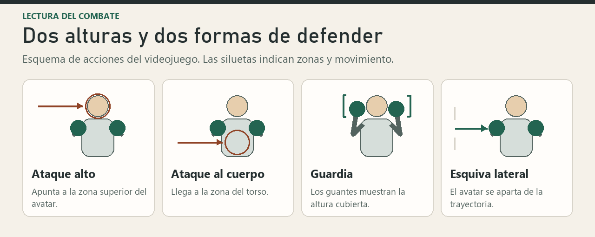
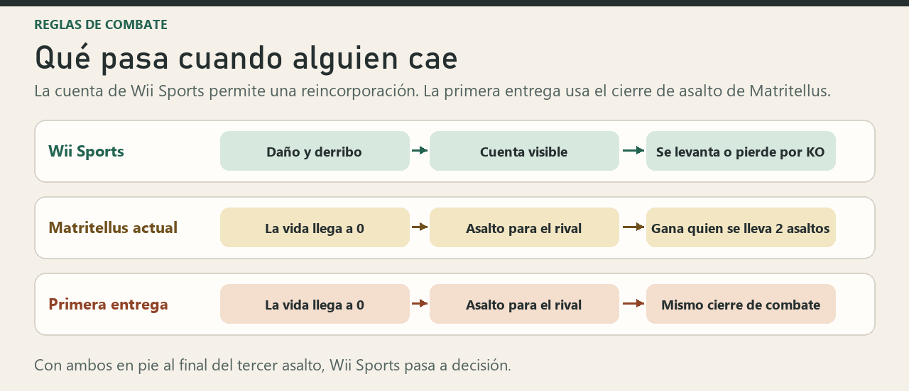
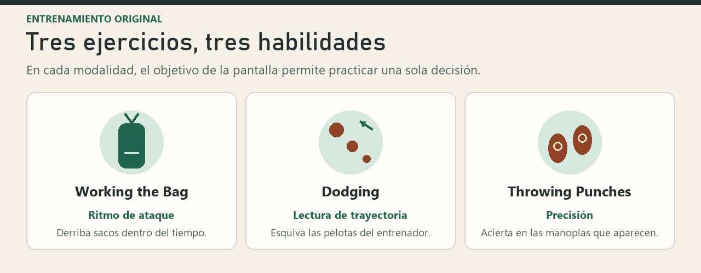
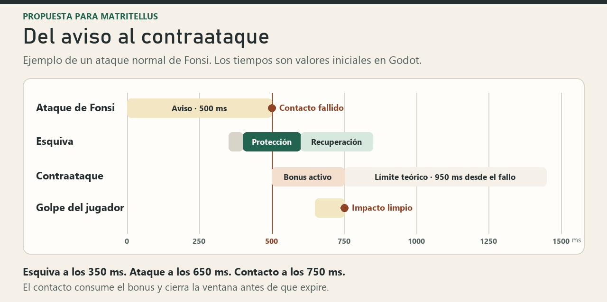
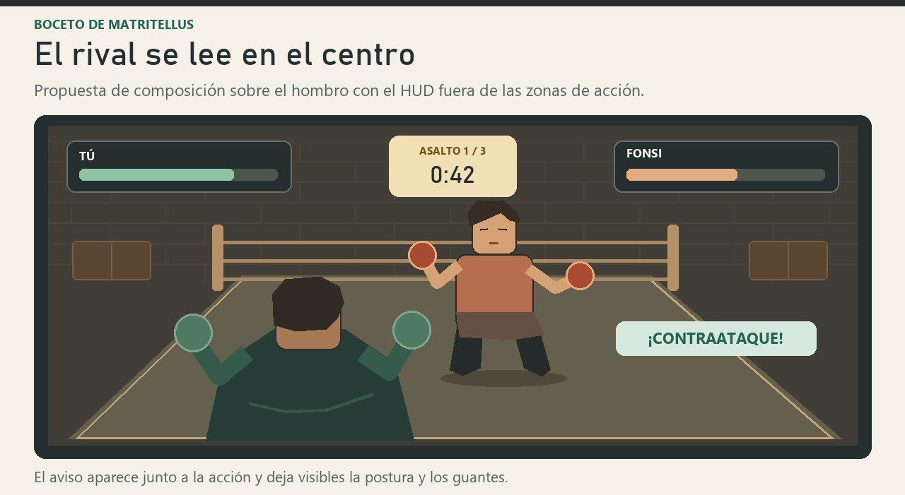
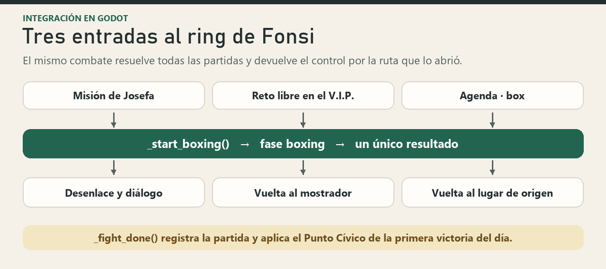

# Boxeo de Wii Sports

Estudio del minijuego de **Wii Sports para Wii (2006)** y propuesta para evolucionar el combate de Fonsi en **Matritellus**. El rival se prepara, el jugador se cubre o esquiva, y el fallo deja una oportunidad breve para responder.

- [Cómo funciona el original](#cómo-funciona-el-original)
- [Qué mirar en grabaciones y capturas](REFERENCIAS.md)
- [Qué hay ya en Matritellus](#qué-hay-ya-en-matritellus)
- [Propuesta para Godot](#propuesta-para-godot)
- [Prompt de implementación listo para copiar](PROMPT.md)

## Cómo funciona el original

### Controles y decisiones

Nintendo asigna una mano al Wii Remote y la otra al Nunchuk. Cada mando acciona su propio guante. Las dos manos delante del pecho sirven de posición de guardia. El manual en español describe el gesto hacia arriba o abajo para elegir altura. La página japonesa ilustra esa misma distinción con el mando más vertical o más horizontal. Son descripciones del control por movimiento, sin especificaciones de los umbrales internos. [Manual de Nintendo, sección Boxeo](https://csassets.nintendo.com/noaext/image/private/t_KA_PDF/Wii_Wii_Sports?_a=DATC1RAAZAA0) · [Ficha oficial japonesa ilustrada](https://www.nintendo.co.jp/wii/rspj/5sports/boxing.html)

| Acción en el juego | Qué comunica al jugador | Qué estudiar en pantalla |
| --- | --- | --- |
| Golpear con una mano u otra | Los guantes ofrecen dos acciones directas | Qué mano sale y cuánto tarda en volver a guardia |
| Atacar arriba o al cuerpo | Cambia la altura del objetivo | Cómo se distinguen las siluetas y qué zona queda expuesta |
| Cubrirse | Los guantes del avatar anticipan la defensa | Diferencia visual y sonora entre contacto en guardia e impacto limpio |
| Inclinarse o apartarse | El avatar se desplaza con la postura | Si el golpe pasa de largo y en qué momento el rival queda abierto |
| Contraatacar | Una esquiva ajustada puede ir acompañada de ralentización | Fotograma del fallo, señal del hueco y retorno del rival a guardia |

Las variantes como ganchos y golpes ascendentes, los sonidos de distinta intensidad y la ralentización al esquivar por poco aparecen en pruebas contemporáneas. La regla de activación, el daño y la duración exacta de la ventana quedan por medir a partir de vídeo o juego directo. [GAME Watch, sección de boxeo](https://game.watch.impress.co.jp/docs/20070111/wiisp.htm)

### Asaltos, caídas y resultado

1. **Combate en solitario o duelo local.** Se puede jugar contra la CPU o contra otra persona con un juego de mandos por participante. En solitario, el encuadre mira sobre el avatar propio hacia el rival. El duelo local presenta dos vistas lado a lado. [Combate en solitario](https://www.youtube.com/watch?v=z6KKz9U8EIg&t=1557s) · [Captura de la pantalla partida](https://game.watch.impress.co.jp/docs/20070111/wiisp26.htm)
2. **Hasta tres asaltos de un minuto de reloj de juego.** Recibir impactos reduce el indicador de salud. Cuando un luchador cae, se ve una cuenta. Una reincorporación permite continuar y llegar al final de la cuenta puede cerrar el combate por KO. Se aprecia la diferencia en la secuencia de derribo, reincorporación y KO de la galería. [Reglas de Nintendo](https://www.nintendo.co.jp/wii/rspj/5sports/boxing.html) · [Secuencia de capturas en MobyGames](https://www.mobygames.com/game/25099/wii-sports/screenshots/)
3. **Si ambos llegan al final del tercero, hay decisión.** El manual confirma este desenlace y deja abierta la fórmula de puntuación. La pausa y las transiciones impiden deducir tiempos de simulación a partir de la duración total de una grabación. [Manual de Nintendo](https://csassets.nintendo.com/noaext/image/private/t_KA_PDF/Wii_Wii_Sports?_a=DATC1RAAZAA0)
4. **La habilidad progresa contra la CPU.** El manual describe un nivel que sube o baja según la actuación, con categoría Pro al superar los 1.000 puntos. En el duelo entre dos personas, el nivel queda igual. El combate contra Matt sirve para estudiar cómo cambia la presión en un rival avanzado. [Manual de Nintendo, Nivel de Habilidad](https://csassets.nintendo.com/noaext/image/private/t_KA_PDF/Wii_Wii_Sports?_a=DATC1RAAZAA0) · [Grabación frente a Matt, 41:51](https://www.youtube.com/watch?v=7l_fy6udoM8&t=2511s)

### Presentación y ritmo

- **Cámara.** De espaldas al avatar del jugador, se ve la guardia del rival y el movimiento de los guantes. Las dos vistas del versus conservan la perspectiva de cada participante. [Captura oficial](https://www.nintendo.co.jp/wii/rspj/5sports/img/boxing.jpg) · [Duelo local grabado](https://www.youtube.com/watch?v=axP6WvWMGrM)
- **Anticipación.** Busca el primer cambio de postura antes de que el ataque salga. Compara un intercambio limpio con otro en que el rival falla. La diferencia entre esos dos casos es más útil para calibrar el prototipo que contar golpes por minuto. [Prueba de GAME Watch](https://game.watch.impress.co.jp/docs/20070111/wiisp.htm)
- **Confirmación.** Aire, bloqueo e impacto requieren señales distintas. En el original, el sonido del impacto, la vibración y la reacción del avatar se refuerzan entre sí. Observa si el resultado sigue siendo reconocible con el sonido silenciado. [Prueba de GAME Watch](https://game.watch.impress.co.jp/docs/20070111/wiisp.htm)
- **Interrupciones.** Campana, caída, cuenta y resultado deben leerse como cambios del estado del combate. Al estudiar una caída, sigue la cámara, la interfaz y la acción hasta que se reanude el asalto o aparezca el resultado. [Galería de MobyGames](https://www.mobygames.com/game/25099/wii-sports/screenshots/)

### Entrenamiento

| Ejercicio original | Qué exige | Qué mide | Gameplay |
| --- | --- | --- | --- |
| Working the Bag | Encadenar impactos contra sacos que ofrecen distinta resistencia | Sacos derribados dentro del tiempo | [1:04:56](https://www.youtube.com/watch?v=z6KKz9U8EIg&t=3896s) |
| Dodging | Apartarse de pelotas lanzadas por el entrenador | Pelotas esquivadas | [1:06:36](https://www.youtube.com/watch?v=z6KKz9U8EIg&t=3996s) |
| Throwing Punches | Seleccionar las manoplas que muestra el entrenador | Precisión, con penalización al alcanzar al entrenador | [1:08:11](https://www.youtube.com/watch?v=z6KKz9U8EIg&t=4091s) |

Cada ejercicio aísla una habilidad que luego se combina con las demás en combate. Para Matritellus, una introducción breve que enseñe a esquivar y responder puede aprovechar ese principio con la misma escena del V.I.P. [Grabación de LongplayArchive](https://www.youtube.com/watch?v=z6KKz9U8EIg&t=3896s) · [Descripción de los ejercicios](https://gamefaqs.gamespot.com/wii/933010-wii-sports/faqs/45923)

## Qué hay ya en Matritellus

La copia consultada en `X:/Matritellus` declara Godot 4.7 y el README del proyecto indica 4.7.2. También se comprobó que el archivo de boxeo de `X:/MatritellusGPT` era idéntico. Las referencias siguientes son rutas relativas al repositorio del juego.

| Archivo o flujo | Comportamiento actual | Qué reutilizar |
| --- | --- | --- |
| `godot/scripts/boxing.gd` | Ataque único, esquiva a ambos lados, guardia al mantener atrás. Fonsi anuncia ataques normales y fuertes. Esquivar abre un intervalo de contraataque. | `setup()`, `start()`, `act()`, `tick()`, `direction()`, animación base y campanas. |
| `godot/scripts/boxing.gd`, reglas | Mejor de tres asaltos de 60 s. Una caída concede el asalto de inmediato. Si se acaba el tiempo, gana el que conserva más vida y el empate favorece al jugador. Ambos recuperan toda la vida al comenzar otro asalto. | Mantener las reglas de misión y tanteo como base de la primera entrega. |
| `godot/scripts/game.gd` | `_start_boxing()` entra en la fase `boxing` y coloca a Fonsi, jugador y vecinos en el ring. `_box_over()` resuelve la misión. `_vip_spar_go()` y `_play_minigame("box", ...)` pasan por el mismo combate y vuelven por `_minigame_over()`. | El ring de la trastienda, la cámara sobre el hombro, la devolución de control y las salidas existentes. |
| `game.gd` y `missions.gd` | El registro usa el identificador `box`. `_fight_done()` registra récord y partidas, y da 1 Punto Cívico por la primera victoria de cada día. Hay rutas que desbloquean el minijuego al ganar a Fonsi. | Conservar las claves guardadas, las rutas de desbloqueo y un único cierre por partida. |
| `controls.gd`, `touch.gd`, `hud.gd`, `loc.gd`, `sfx.gd` | Acciones y glifos comunes, botones táctiles de boxeo, marcador, textos ES/EN y efectos propios. Durante el combate, `game.gd` también acepta `interact` y `handbrake` como golpes. | Extender el contexto de boxeo con controles específicos. Mantener los alias existentes y comprobar que una pulsación produce una sola acción. |
| `godot/scripts/selftest.gd` | La prueba integrada fuerza la ventana de contra, la esquiva, un derribo, el desenlace de la misión y una revancha desde la agenda. Parte de la prueba asigna directamente estados internos. | Migrar las preparaciones de prueba que cambien y conservar las comprobaciones de comportamiento e integración. |

## Propuesta para Godot

### Primera entrega

Evolucionar el combate que ya existe. Mantener a Fonsi, el V.I.P., la cámara del juego y las reglas actuales de los asaltos. Incorporar **dos manos, dos alturas, una guardia visible y un solo contraataque mejorado por esquiva limpia**. El rival anuncia cada ataque con una postura diferente. El aspecto y el sonido salen de Matritellus.

1. **Controles.** Mantener `left` / `right`, `back` y los alias del golpe actual. Añadir `box_punch_other` y `box_low` si encajan con el mapa de acciones. El golpe primario conserva su enlace. El modificador de altura se lee al aceptar la acción y se aplica también a la guardia sostenida. Exponer la segunda mano y un selector de altura en táctil. El selector vuelve a alto al salir o reiniciar. Comprobar en el juego los botones concretos para evitar conflictos.
2. **Resolución.** Caída y descanso cancelan el intercambio. Durante el contacto, la esquiva válida provoca un fallo y la guardia a la altura correcta mitiga el golpe, que de otro modo es un impacto limpio. La esquiva cambia de lado en pantalla y necesita un nuevo flanco para reactivarse. Para esta primera entrega, cualquier dirección esquiva si la fase invulnerable cubre el contacto.
3. **Ritmo.** Diferenciar preparación, contacto y recuperación. Una esquiva limpia abre una ventana indicada por pose y sonido. El primer impacto limpio durante esa ventana consume el bonus. El jugador puede atacar en la recuperación de su esquiva. Si continúa manteniendo guardia, deberá soltarla o iniciar el golpe para dejar de cubrirse mientras ataca.
4. **IA.** Fonsi elige ataque alto o bajo antes de anunciarlo. Reusar su estructura básica y añadir un perfil de tiempos y pesos ajustable. La IA mantiene la elección hasta el contacto. Para probarla, permitir fijar la semilla o inyectar una secuencia de ataques. El rival inicial debe dejar tiempo suficiente para reconocer cada señal.
5. **Presentación.** Lectura prioritaria del rival, indicadores del juego y avisos breves. Separar los sonidos de aire, bloqueo, golpe limpio y contraataque. La celebración y las campanas deben quedar sincronizadas con el resultado. Para esta entrega basta una indicación audiovisual local de contraataque con velocidad de juego normal.

### Valores de arranque

Estos son **valores propuestos para el prototipo**, sujetos a pruebas de juego. A 60 pasos/s, un paso dura aproximadamente 16,7 ms. Expresar los tiempos en segundos en el código y mantener el orden de resolución estable en cada paso de simulación.

| Parámetro | Arranque | Uso |
| --- | --- | --- |
| Vida | 100 por luchador | Reiniciar al empezar cada asalto, como hoy |
| Aviso de Fonsi | 500 ms normal, 800 ms fuerte | La altura se lee en la pose, la potencia en el ritmo |
| Golpe del jugador | 100 ms de preparación, 50 ms activos, 200 ms de recuperación | Una sola resolución por golpe, incluso si permanece activo varios pasos |
| Esquiva | 50 ms de inicio, 200 ms de protección, 250 ms de recuperación | Habilitar ataque durante la recuperación y otra esquiva al terminar |
| Ventana de contra | 950 ms desde el fallo de Fonsi | Se comprueba en el contacto del golpe del jugador. El primer impacto limpio la consume |
| Daño del jugador | 6 normal, 12 con contra, 1 contra guardia correcta | Misma base para las dos manos al comenzar |
| Daño del rival | 16 normal, 28 fuerte, ×0,2 en guardia correcta | Se conserva la escala de Matritellus |
| Pausa entre asaltos | 3,4 s | Limpiar órdenes pendientes, animación de ataque y ventana de contra |

**Orden para casos límite.** Al agotarse el reloj, cerrar el asalto antes de nuevos contactos en ese paso, como en el combate actual. Para contactos simultáneos, evaluar ambos con el mismo estado previo y aplicar el daño en bloque. Si ambos llegan a cero, usar la regla vigente de desempate a favor del jugador y registrar un solo final de asalto. Contar los pasos de contacto dentro de la ventana con un criterio de borde explícito y probarlo.

### Integración y pruebas de aceptación

| Escenario | Resultado esperado |
| --- | --- |
| Fonsi inicia un ataque alto o bajo | La señal corresponde a la altura que se resuelve. Golpe alto y guardia alta, y golpe bajo y guardia baja, mitigan. Las opciones cruzadas causan daño limpio. |
| Esquiva pronto, en tiempo o tarde | Solo el contacto dentro de la fase protegida falla. La señal y el bonus aparecen una vez. Dos impactos limpios durante el hueco producen 12 y 6 de daño. |
| Entradas simultáneas, tecla repetida o toque mantenido | Cada orden de ataque aceptada da un solo golpe. La prioridad entre órdenes del mismo paso es estable. Cruzar el umbral del stick dispara una sola esquiva hasta volver a neutro. |
| Contacto en el mismo paso que la campana final o un doble derribo | El orden de resolución es estable. Se emite un único resultado de asalto y, cuando corresponda, un solo final de combate. |
| Fin de asalto, victoria, derrota o revancha | Se limpian entradas y estados visuales. Tras dos asaltos ganados por el mismo luchador se llama una vez al cierre. Reentrar no arrastra el estado del combate anterior. |
| Misión de Josefa, reto libre al V.I.P. y combate desde la agenda | Funcionan el desbloqueo, récord, conteo, recompensa diaria, retorno al lugar correcto y lectura de una partida guardada anterior. Comprueba victoria y derrota en la misión y la agenda. |
| Teclado/ratón, mando y táctil | Se puede golpear con ambas manos, elegir altura, cubrirse y esquivar durante un combate real con cada dispositivo. Se respetan glifos, cambio de dispositivo y espacio del HUD a distintas relaciones de aspecto. |

El stick táctil actual actualiza acciones con `Input.action_press()`, mientras la rama de boxeo en `game.gd` atiende las esquivas desde eventos. Comprueba ambas rutas y centraliza la detección del flanco si hace falta, de modo que teclado, stick y botones no disparen duplicados. [API Input de Godot](https://docs.godotengine.org/en/stable/classes/class_input.html)

Una segunda entrega podría ofrecer un modo opcional de **caída, cuenta y reincorporación**, con reglas propias para el KO y una decisión documentada al término de los tres asaltos. Esa variante requiere acordar cómo puntúa el registro y cómo se comportan misión y recompensas. Una práctica con objetivos de altura y un duelo local son ampliaciones independientes.

Documentación técnica de apoyo. [InputMap](https://docs.godotengine.org/en/stable/classes/class_inputmap.html) · [Procesamiento en pasos de física](https://docs.godotengine.org/en/stable/tutorials/scripting/idle_and_physics_processing.html) · [Uso de semillas en RandomNumberGenerator](https://docs.godotengine.org/en/stable/classes/class_randomnumbergenerator.html) · [Godot por línea de comandos](https://docs.godotengine.org/en/stable/tutorials/editor/command_line_tutorial.html)
