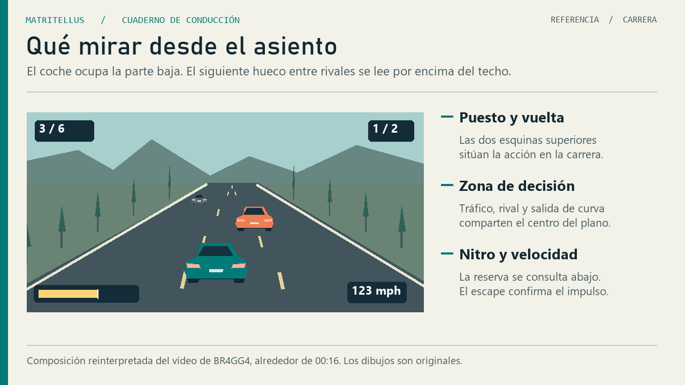
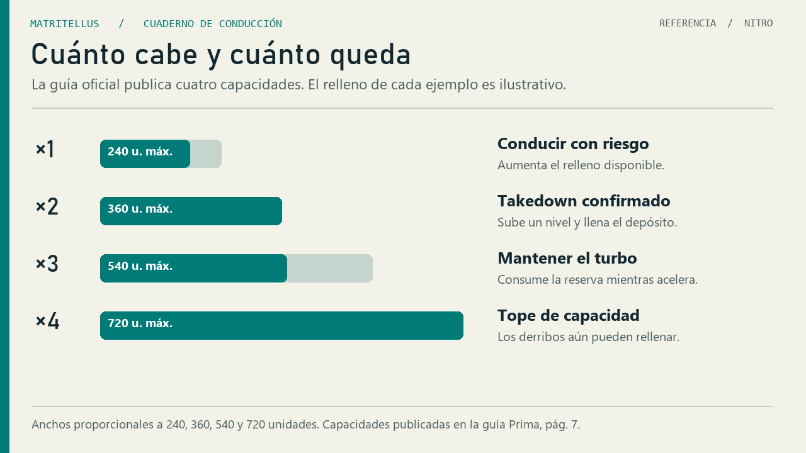
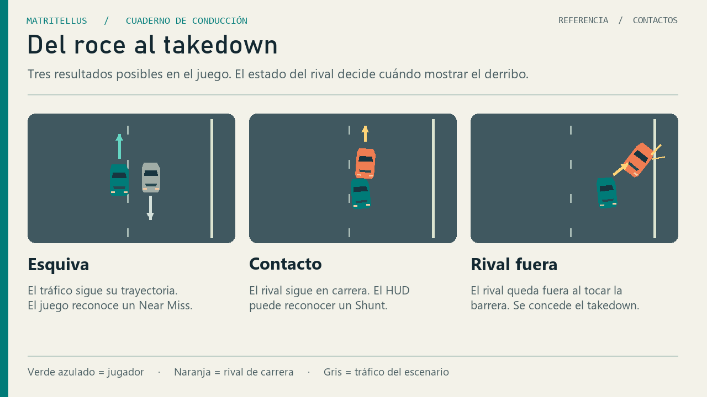
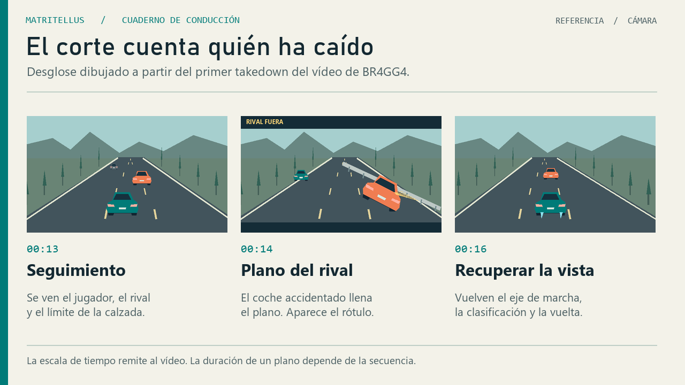
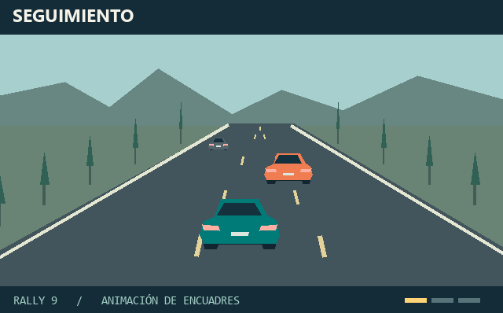
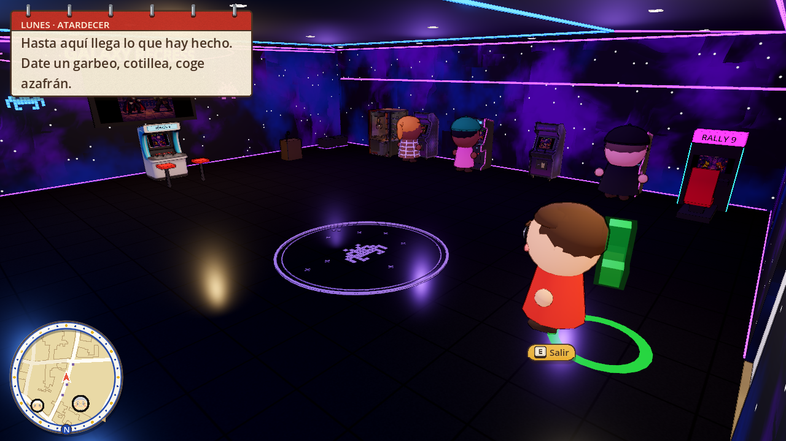
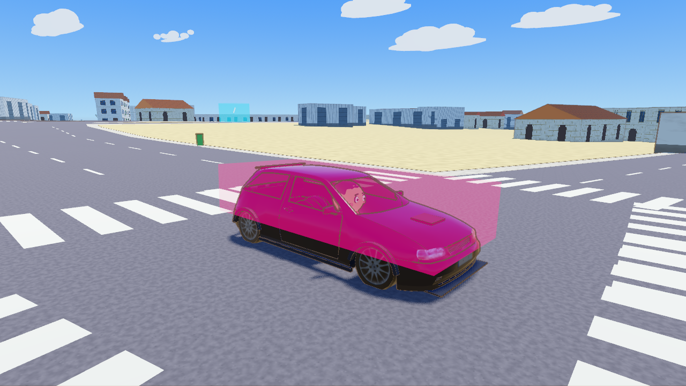
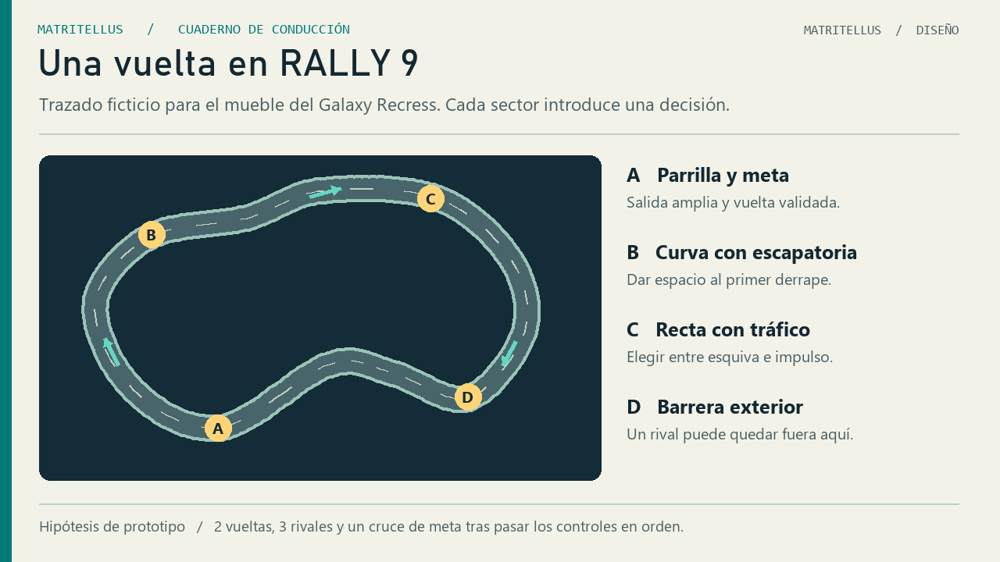

# Burnout 3: Takedown · Cómo se juega una carrera

**Dossier de diseño para RALLY 9, la recreativa de conducción de Matritellus.** La idea que merece llevarse a Godot es que el jugador pueda ganar una carrera de dos maneras durante la misma vuelta. Puede buscar un hueco y adelantar, o disputar la posición a un rival para conseguir más nitro. El plano del derribo dura lo justo para entender quién ha caído. Enseguida hay que volver a leer la siguiente curva.

Para ver todo el ciclo en menos de medio minuto, abre el vídeo de BR4GG4 en **00:13**. Primero identifica el coche azul del jugador. Sigue después al coche negro que acaba en la barrera y vuelve a buscar el azul cuando se restablezca la vista trasera. A **00:25** cambia el protagonista del accidente. Esa diferencia explica las dos cámaras más importantes del juego. [Contacto y derribo, 00:13](https://www.youtube.com/watch?v=0UO-z_p4vGM&t=13s) · [Accidente propio, 00:25](https://www.youtube.com/watch?v=0UO-z_p4vGM&t=25s)

El ZIP contiene este README, una [edición para abrir en el navegador](LEEME.html), cinco láminas originales, una animación de encuadres, dos capturas del proyecto y el [prompt completo para Godot](PROMPT.md). Las imágenes se pueden consultar sin conexión. Los enlaces de vídeo abren los originales. Las primeras secciones describen la edición de 2004 y el vídeo de referencia. La sección **RALLY 9 en Matritellus** contiene las decisiones propuestas para el prototipo.

## Leer una vuelta

En *Race*, la posición al cruzar la meta decide la clasificación. En la partida de referencia corren seis coches y el contador indica dos vueltas. El puesto y la vuelta ocupan las esquinas superiores, la velocidad está abajo a la derecha y el nitro abajo a la izquierda. Los ordinales flotantes ayudan a reconocer a los competidores entre los coches de tráfico. Los puntos de maniobra aparecen por separado. Puedes hacer un derribo espectacular y seguir teniendo que adelantar al líder. [Gameplay, 00:16](https://www.youtube.com/watch?v=0UO-z_p4vGM&t=16s) · [Manual de EA para PS2, pp. 4–5](https://db.hfsplay.fr/files/2019/09/19/Burnout_3_-_Takedown_001_vyihoNM.pdf)

**El ritmo cambia según dónde estés en el grupo.** Al salir, varios rivales comparten encuadre y es fácil que un contacto tenga consecuencias. En cabeza, mandan el tráfico y la geometría de la pista. Las flechas luminosas anuncian por dónde continúa una curva y los bordes de la calzada permiten estimar la velocidad. En el vídeo se puede pasar de mirar una etiqueta de posición sobre un rival a buscar la siguiente flecha en el horizonte en apenas unos segundos. [Pelotón, 00:16](https://www.youtube.com/watch?v=0UO-z_p4vGM&t=16s) · [Flechas de dirección, 00:19](https://www.youtube.com/watch?v=0UO-z_p4vGM&t=19s)

| Modalidad del original | Qué decide el resultado | Para qué sirve como referencia |
| --- | --- | --- |
| Race | Posición en meta | Plantilla para la recreativa. El derribo ayuda a ganar terreno y reserva. |
| Road Rage | Número de rivales derribados dentro del tiempo disponible. Los daños acumulados pueden terminar el intento. | Permite estudiar muchos contactos seguidos y cómo el HUD comunica el objetivo. |
| Eliminator / Face-Off | En Eliminator cae el último de cada vuelta. Face-Off enfrenta a dos pilotos. | Muestran cómo cambia la presión al reducirse el grupo. |
| Burning Lap / Grand Prix | Una vuelta contra el reloj / puntos por posición a lo largo de varias carreras. | Referencias para estudiar la trazada y la regularidad. |
| Crash | Valor de los daños en un cruce preparado. Incluye objetos y *Crashbreaker*. | Sirve para comparar cómo se filma un choque cuando el choque es el objetivo de la prueba. |

Fuentes de los modos y sus condiciones de victoria. [Manual de EA, pp. 4–7](https://db.hfsplay.fr/files/2019/09/19/Burnout_3_-_Takedown_001_vyihoNM.pdf) · [Prueba de la versión Xbox publicada, GameSpot](https://www.gamespot.com/reviews/burnout-3-takedown-review/1900-6106835/)

## Control y respuesta del coche

| Acción en PS2 | Control documentado | Respuesta que interesa reproducir |
| --- | --- | --- |
| Acelerar / frenar | ✕ / □, o palanca derecha arriba / abajo | Modulación de velocidad antes de disputar una curva. |
| Girar | Palanca izquierda o cruceta | Dirección inmediata. En curva, una pulsación breve de freno ayuda a iniciar el deslizamiento y volver al gas lo sostiene. |
| Usar nitro | Mantener R1 con reserva disponible | El impulso se puede dosificar. Al levantar el dedo se puede guardar lo que queda para la salida de la curva. |
| Mirar atrás / cambiar de vista | L1 / triángulo | Permite comprobar dónde está un rival o cambiar la perspectiva habitual. |
| Impact Time / Aftertouch | Durante un accidente propio, mantener R1 para la cámara lenta. La palanca izquierda o cruceta influye sobre los restos. | Un mismo botón cambia de significado según el estado del coche. El accidente aún contiene una decisión jugable. |

Controles de la edición PS2 y técnica de derrape descrita en la guía oficial. [Manual de EA, p. 2](https://db.hfsplay.fr/files/2019/09/19/Burnout_3_-_Takedown_001_vyihoNM.pdf) · [Guía Prima, sección *General Strategies*](https://www.ogxbox.co.uk/media/com_eshop/attachments/Burnout_3_Takedown_Strategy_Guide_2004_Book.pdf)

## Nitro · ganar carga, ampliar la reserva y gastarla

Piensa en dos valores. **La carga** es el combustible que queda ahora. **La capacidad** es lo que cabría con el depósito lleno. Una esquiva muy cercana, un derrape, tiempo circulando en sentido contrario, un salto o seguir de cerca a otro coche generan carga. Los contactos con rivales también tienen recompensa. Un takedown confirmado rellena la barra y sube su nivel hasta ×4. Un accidente propio normalmente hace perder un nivel adicional ganado. Un *Aftertouch Takedown* permite conservar ese nivel. [Manual de EA, pp. 5–6](https://db.hfsplay.fr/files/2019/09/19/Burnout_3_-_Takedown_001_vyihoNM.pdf) · [Guía Prima, tablas de maniobras y capacidad](https://www.ogxbox.co.uk/media/com_eshop/attachments/Burnout_3_Takedown_Strategy_Guide_2004_Book.pdf)

La guía Prima publica **240, 360, 540 y 720 unidades** para los indicadores ×1 a ×4. La etiqueta ×4 representa el cuarto nivel de depósito. Para verlo en pantalla, compara el ×2 que aparece tras el primer derribo con el ×4 y la barra larga que se ven después de los accidentes en cadena. El escape azulado, la velocidad y el movimiento de los bordes del plano permiten reconocer el impulso aunque el jugador tenga la vista puesta en la carretera. [Guía Prima, p. 7](https://www.ogxbox.co.uk/media/com_eshop/attachments/Burnout_3_Takedown_Strategy_Guide_2004_Book.pdf) · [Reserva ×2, alrededor de 00:18](https://www.youtube.com/watch?v=0UO-z_p4vGM&t=18s) · [Reserva ×4, 00:36](https://www.youtube.com/watch?v=0UO-z_p4vGM&t=36s)

**Ejemplo de decisión.** Un rival ocupa el centro de la recta y se acerca una curva. Gastar ahora parte de la barra permite disputarle la posición. Guardarla permite acelerar cuando vuelvan a abrirse los carriles. Si el duelo acaba en derribo, el relleno del depósito cambia el plan para la salida de la curva. Esta lectura explica por qué el medidor necesita mostrar a la vez cuánto queda y cuánto se puede acumular.

## Contactos, takedowns y accidente propio

| Lo que ocurre en pantalla | Qué resuelve el juego | Qué conviene observar |
| --- | --- | --- |
| El jugador pasa muy cerca de un vehículo de tráfico | *Near Miss*. Se reconoce la esquiva y se gana carga. | El tráfico continúa y la cámara permanece detrás del jugador. |
| Dos competidores se tocan y ambos siguen rodando | Maniobras como *Shunt* o *Slam* reconocen el contacto. Pueden dar puntos y nitro. | El aviso de contacto puede aparecer antes del resultado definitivo. |
| Un rival acaba accidentado contra una barrera o el tráfico tras la disputa | *Wall Takedown* o derribo asociado al vehículo que intervino. | El rótulo señala el resultado y la cámara puede dedicarle un plano al rival. |
| El jugador se accidenta | Se abre *Impact Time*. *Aftertouch* permite variar ligeramente el recorrido de los restos. Alcanzar a un rival puede conceder un derribo. | El coche accidentado del jugador pasa a ser el sujeto del plano. Sigue habiendo una intervención posible. |
| Caen varios rivales, se devuelve un derribo o se usa un elemento concreto de la pista | El juego reconoce derribos múltiples, *Revenge* y *Signature*, entre otras variantes. | El texto cuenta qué tuvo de especial el mismo suceso físico. |

Reglas, tipos de contacto y ejemplos de la partida. [Guía Prima, tablas de movimientos y takedowns](https://www.ogxbox.co.uk/media/com_eshop/attachments/Burnout_3_Takedown_Strategy_Guide_2004_Book.pdf) · [Contacto con el rival, 00:13](https://www.youtube.com/watch?v=0UO-z_p4vGM&t=13s) · [Aftertouch, 00:25](https://www.youtube.com/watch?v=0UO-z_p4vGM&t=25s)

Un detalle importante para el diseño es la **atribución**. En el vídeo, el contacto inicial y el resultado que merece el plano especial se entienden por separado. La guía incluso recoge *Psyche Out*, cuando un rival se accidenta bajo presión al seguirlo de cerca. Para una primera versión en Godot basta con recordar un contacto reciente entre participantes y comprobar después que el rival ha quedado fuera. Esa regla propuesta es más sencilla de depurar y de explicar al jugador. [Guía Prima, tabla *Takedown Type*](https://www.ogxbox.co.uk/media/com_eshop/attachments/Burnout_3_Takedown_Strategy_Guide_2004_Book.pdf)

## Cámara · a quién mirar y cuándo volver

| Estado | Sujeto y movimiento del plano | Información que debe seguir siendo legible |
| --- | --- | --- |
| Conducción | Cámara trasera cercana. El coche queda abajo y el punto de fuga se adelanta sobre la carretera. | Próxima curva, hueco libre, rival más cercano. |
| Impulso | El coche sigue como referencia estable. El flujo de los laterales, el escape y el sonido acentúan la velocidad. | El centro de la calzada y las flechas de dirección. La grabación permite apreciar el efecto, pero no medir el ángulo de visión del motor. |
| Takedown de un rival | La vista abandona la posición trasera, se acerca al coche accidentado y muestra el obstáculo. El rótulo confirma el derribo. | Qué rival ha caído y por qué se concede la recompensa. En el ejemplo de la barrera todavía se ve el coche azul alejándose. |
| Regreso | Se recuperan la trasera del jugador, los indicadores habituales y el sentido de avance. | La próxima maniobra se entiende en el primer plano de vuelta. |
| Accidente propio | Cambia el foco a los restos del jugador. *Impact Time* alarga la lectura y *Aftertouch* les da una influencia direccional limitada. | El jugador debe distinguir cuándo todavía puede intervenir y cuándo recupera la conducción. |

El menú original permite activar o desactivar la cámara de takedown y elegir *Impact Time* manual o automático. Es una buena referencia para conservar el feedback del derribo cuando se opta por ver continuamente la carretera. [Manual de EA, p. 13](https://db.hfsplay.fr/files/2019/09/19/Burnout_3_-_Takedown_001_vyihoNM.pdf) · [Paso del plano del rival a conducción, 00:14–00:16](https://www.youtube.com/watch?v=0UO-z_p4vGM&t=14s) · [Prueba de cámara y efectos por GameSpot](https://www.gamespot.com/articles/burnout-3-takedown-feature-preview/1100-6104473/)

El GIF repite los tres encuadres con tiempos ilustrativos para facilitar la comparación. Las marcas de la lámina corresponden al vídeo del usuario. Para ajustar la duración de una transición en Godot, fíjate en cuándo puedes volver a elegir carril con confianza.

## Guía de visionado

Estos enlaces abren puntos concretos del vídeo de **BR4GG4**, de 11 min 46 s. Los segundos sitúan fotogramas observados. Para seguir el movimiento, arranca un instante antes del rótulo que quieras estudiar. [Gameplay completo](https://www.youtube.com/watch?v=0UO-z_p4vGM)

| Instante | Qué aparece | Qué mirar al repetirlo |
| --- | --- | --- |
| [00:08](https://www.youtube.com/watch?v=0UO-z_p4vGM&t=8s) | Coche azul, salida en grupo, aviso *Near Miss* y escape encendido. | Sigue el centro de la calzada una vez y el extremo inferior izquierdo la segunda. |
| [00:13](https://www.youtube.com/watch?v=0UO-z_p4vGM&t=13s) | Aparece *Shunt*. Un rival negro se inclina en el lateral derecho. | El contacto ya es legible desde la vista normal. |
| [00:14](https://www.youtube.com/watch?v=0UO-z_p4vGM&t=14s) | *Wall Takedown*. El coche negro y la barrera dominan el plano. | Localiza también el azul al fondo. Así se entiende la dirección del desplazamiento. |
| [00:16](https://www.youtube.com/watch?v=0UO-z_p4vGM&t=16s) | Regresa la vista trasera. Un rival rojo sigue a la derecha. | Lee el puesto y localiza el siguiente hueco antes de mirar el marcador. |
| [00:19](https://www.youtube.com/watch?v=0UO-z_p4vGM&t=19s) | Las flechas luminosas anuncian la curva. Delante aparece la etiqueta del primero. | Observa cómo la señalización grande sigue siendo legible bajo impulso. |
| [00:25](https://www.youtube.com/watch?v=0UO-z_p4vGM&t=25s) | El azul va de costado. Aparecen *Impact Time* y *Aftertouch Takedown*. | Compara el dueño del coche mostrado con el de 00:14. |
| [00:29](https://www.youtube.com/watch?v=0UO-z_p4vGM&t=29s) y [00:32](https://www.youtube.com/watch?v=0UO-z_p4vGM&t=32s) | Los rótulos pasan por doble y triple derribo durante la secuencia. | Observa cómo se actualiza la comunicación dentro del mismo accidente. |
| [00:36](https://www.youtube.com/watch?v=0UO-z_p4vGM&t=36s) y [00:44](https://www.youtube.com/watch?v=0UO-z_p4vGM&t=44s) | Primero vuelve la vista trasera con ×4. Más tarde aparece *Drift* y sus estrellas. | Compara la capacidad de la barra, su relleno y la confirmación de la maniobra. |

**Otras referencias visuales y de gameplay**

| Recurso | Uso en una sesión de diseño |
| --- | --- |
| [World Tour de Tank_09YT · Silver Lake, Race, 02:12](https://www.youtube.com/watch?v=VNLOh25Tf40&t=132s) | Inicio de capítulo indicado por el autor. Observar cómo se presenta una prueba por posición y cómo se separa el pelotón. |
| [La misma partida · Downtown, Road Rage, 08:28](https://www.youtube.com/watch?v=VNLOh25Tf40&t=508s) | Comparar el objetivo y el marcador con la carrera anterior. |
| [La misma partida · Waterfront, Burning Lap, 13:10](https://www.youtube.com/watch?v=VNLOh25Tf40&t=790s) | Estudiar trazada, impulso y visibilidad en una prueba contra el reloj. |
| [Gameplay Movie 11 · GameSpot, ficha de GameFAQs](https://gamefaqs.gamespot.com/ps2/919649-burnout-3-takedown/videos/26106873) | Clip dedicado a la relación entre derribos y recarga. |
| [Manual original de PS2, edición francesa](https://db.hfsplay.fr/files/2019/09/19/Burnout_3_-_Takedown_001_vyihoNM.pdf) | Abrir las páginas impresas 4–5 para ver el HUD anotado. Las pp. 2, 6 y 13 cubren controles, accidentes y ajustes. |
| [Guía oficial Prima, PDF ilustrado](https://www.ogxbox.co.uk/media/com_eshop/attachments/Burnout_3_Takedown_Strategy_Guide_2004_Book.pdf) | Consultar *General Strategies* para la economía del nitro y *Track Appendix* para comparar mapas, curvas y densidad de tráfico. |

## RALLY 9 en Matritellus

**Punto de entrada propuesto.** En la copia consultada, `X:\MatritellusGPT`, el Galaxy Recress ya tiene un mueble de conducción llamado **RALLY 9**, con volante y asiento rojo junto a la entrada. La interacción libre de las máquinas lleva a Tokken 9. Dar al asiento de RALLY 9 su propio punto de interacción permite que una partida empiece y acabe en un lugar reconocible del pueblo. La carrera puede usar El Tunero, un circuito de recreativa y rivales propios. El jugador vuelve al mismo asiento tras ver el resultado.

Captura del proyecto, `godot/shots/recress_17_dentro.png`. El indicador verde marca la salida del local. El punto de interacción propuesto pertenece al asiento de la máquina, unos pasos más allá.

### Piezas del proyecto que ya existen

Rutas relativas a la raíz de la copia consultada. Su `project.godot` declara Godot 4.7. Verificar la revisión de trabajo antes de implementar.

| Archivo o función | Qué aporta a la adaptación |
| --- | --- |
| `godot/scripts/recress_sala.gd` · `_hall_build()` | Construye el mueble RALLY 9. Calcular el punto jugable a partir de la misma transformación que coloca el asiento. |
| `recress.gd` · `at_machine()`, `free_play()` y `game.gd` · `interact()` | El juego distingue el reto de historia y el juego libre de Tokken. Dar al asiento una invitación propia, dentro de la sala accesible y con el encargo en el estado apropiado. El horario de juego libre tras la reapertura es de 15:00 a 02:00. |
| `car.gd` · `drive()`, `nitro`, `boosting` | Ya hay física de cuatro ruedas y turbo en El Tunero y el Omega Julietta. En exploración la botella dura 5 s a plena descarga, puede recargarse en 16 s cuando circula cerca de su velocidad máxima y necesita volver al 35 % para recuperarse tras agotarla. En la carrera conviene que una sola lógica administre la reserva por riesgo. |
| `derrape.gd` · `slide_of()` | Hay una medida de deslizamiento y efectos de neumáticos. Reutilizar la señal física para conceder carga cuando realmente desliza. |
| `game.gd` · `_update_camera()`, `_turbo()` | La distancia de la cámara cambia con la velocidad. Ya hay corrección ante obstáculos, efecto de impulso y vibración. La rutina de turbo del mundo también puede alertar a la patrulla. En la recreativa, invocar solo la parte de conducción y presentación pertinente. |
| `controls.gd`, `touch.gd`, `hud.gd`, `loc.gd` | Dirección y pedales, acción de turbo, indicador y textos ES/EN. Usar los glifos y las reasignaciones efectivas del jugador. |
| `traffic.gd`, `selftest.gd` | El tráfico del mundo se recicla y simplifica a distancia. El circuito necesita participantes con identidad durante toda la carrera. El filtro existente `--derrape` ofrece una prueba de regresión. |

Salvo la primera ruta, los scripts de la tabla están en `godot/scripts/`. Las bases de motor para el vehículo y la cámara están descritas en la documentación oficial. [VehicleBody3D](https://docs.godotengine.org/en/stable/classes/class_vehiclebody3d.html) · [Camera3D](https://docs.godotengine.org/en/stable/classes/class_camera3d.html)

Captura del proyecto, `godot/shots/coche_tunero_tres_cuartos.png`. El volumen translúcido permite comparar la silueta que ve el jugador con la caja usada para el contacto. Si una esquiva parece un choque, conviene probar esa diferencia sobre el coche elegido.

### Una primera carrera completa

**Formato propuesto.** Un circuito cerrado, dos vueltas, El Tunero y tres rivales. Una recta ancha permite leer el grupo, una curva amplia invita a derrapar y una segunda recta introduce vehículos de tráfico de la simulación. Reserva una barrera exterior para que un derribo se vea con claridad. Cuenta los pasos de control en orden y en el sentido de carrera. Calcula la posición por vuelta, último control válido y avance en el tramo. La pantalla de meta muestra puesto, tiempo y derribos. El puesto decide la victoria.

**Una vuelta de ejemplo.** Sales con media reserva y un rival a la vista. El primer giro te devuelve algo de carga porque has deslizado el coche. En la recta gastas esa carga para llegar a su altura. Una pasada limpia te da nitro y te deja seguir a fondo. Si el rival termina contra la barrera tras el contacto, el juego confirma el derribo, sube el nivel del depósito y devuelve la vista a la salida de la curva. Si acabas tú fuera, tienes un breve margen de *aftertouch* antes de reaparecer y perder terreno.

| Ajuste inicial para probar | Regla propuesta de RALLY 9 |
| --- | --- |
| Reserva | Capacidades de **100 / 150 / 225 / 300** unidades. Parrilla con **50/100**. Turbo a **32 u/s** mientras se acelera y se mantiene la acción. Al soltar o vaciarse termina el empuje. |
| Ganar carga | **+15** por esquiva completada y **+8 u/s** por derrape válido. Una esquiva requiere pasar al vehículo con velocidad relativa y sin contacto. Se liquida una sola vez al dejarlo atrás. |
| Atribución | Recordar autor, rival e instante de un contacto relevante. Si el rival se accidenta dentro de **1,2 s**, conceder un derribo y rellenar hasta el nuevo límite. Una vida del rival solo puede concederlo una vez. Un roce prolongado no debe refrescar indefinidamente la ventana. |
| Accidente del jugador | *Aftertouch* durante un máximo de **1,0 s** con influencia lateral limitada. Al resolver sin derribo, perder un nivel hasta ×1 y conservar como máximo el **25 % de la nueva capacidad**. Con derribo de aftertouch, conservar el nivel previo y rellenar una vez. |
| Reincorporación | Recolocar el coche en un punto despejado del último tramo válido, orientado al avance. Conceder **0,8 s** de protección simétrica frente a contactos puntuables. Conservar la vuelta en curso. Durante la recuperación los rivales pueden ganar posiciones. |
| Cámara de carrera | Usar la vista del vehículo como base. Ensayar un FOV vertical de **68°** y hasta **+6°** de impulso con interpolación. Posar el objetivo visual unos metros por delante según la velocidad. Ajustar sobre el circuito y el formato de pantalla reales. |
| Cámara del rival | Ensayar **0,55 s** de plano destacado y **0,20 s** de vuelta. La carrera y su cronómetro se detienen durante la exhibición mientras una copia visual anima el accidente. Si la siguiente curva exige decidir ya, usar aviso y sonido con la cámara trasera. |
| Opciones | Modo de cámara continua y efecto de velocidad reducido. Probar con y sin vibración. Con cámara continua se mantienen las confirmaciones y las mismas recompensas. |

Todas las cifras de esta tabla son **valores iniciales de diseño**, ajustables tras jugar una vuelta en Godot. Por ejemplo, si la barra está en 40/100 y derribas a un rival, el resultado propuesto es 150/150. Un segundo de turbo la deja cerca de 118/150. Así se puede comprobar por separado capacidad, consumo y recompensa.

**Controles propuestos.** En teclado, WASD mueve el coche y Mayús mantiene el turbo con la configuración por defecto. En mando, palanca izquierda para girar, RT para acelerar, LT para frenar y RB para turbo. En táctil, dirección con el pulgar izquierdo y pedales y turbo con el derecho. Permitir combinar gas y turbo en pantalla, por ejemplo haciendo que mantener Turbo aporte también gas en la recreativa. Durante un accidente, la dirección pasa a influir sobre los restos. Liberar las acciones al perder foco o abandonar el mueble.

**Orden de implementación.** Primero hacer jugable el trayecto completo desde el asiento hasta la meta y de vuelta al salón. Después conectar reserva, esquivas y derrapes. Por último validar derribos, *aftertouch* y cámara. Usar instancias temporales del vehículo y del tráfico de la prueba. El tiempo, los contactos diferidos y los efectos de cámara pertenecen al intento actual. El cierre debe funcionar igual desde meta, pausa, abandono o reinicio.

### Cuándo está listo para jugar

| Prueba | Resultado observable |
| --- | --- |
| Entrar en RALLY 9 y en una máquina vecina | RALLY 9 abre la carrera. La vecina abre Tokken. Funciona también en una partida guardada anterior a la mejora. |
| Dar marcha atrás sobre la meta u omitir un control | La vuelta solo avanza al completar el recorrido en orden y en el sentido previsto. |
| Derrapar durante un segundo o pasar rozando un coche de tráfico | La carga respeta el límite y coincide a 30 y 60 FPS. Rozar el mismo vehículo durante varios pasos físicos nunca concede varias esquivas. |
| Tocar a un rival que sigue en pie / provocar que quede fuera / ver otro accidente sin participación | Solo el accidente atribuido concede un derribo. Los restos y el tráfico no añaden premios nuevos en los pasos siguientes. |
| Accidentarse con y sin aftertouch válido | Se aplica una sola resolución al depósito. El jugador reaparece mirando hacia la próxima puerta de control, con rivales y tiempo de carrera coherentes. |
| Activar o desactivar el plano de takedown junto a una curva | Se entiende quién cayó y se puede tomar la curva. Tras el corte, la cámara recupera el horizonte y la dirección correctos. |
| Pausar, completar, abandonar y volver a entrar | Se recuperan el salón y los controles. El segundo intento arranca con tres rivales, reserva inicial y marcador limpio. Policía, dinero y coche del mundo mantienen su estado. |
| Teclado, mando y táctil | Se puede acelerar, dirigir y usar nitro al mismo tiempo. Las indicaciones corresponden al dispositivo y se leen en español e inglés. |

Para la implementación, ejecutar las pruebas existentes de derrape y del Galaxy Recress, además de añadir un filtro específico de la carrera si sigue sin existir. Hacer una vuelta con imagen para juzgar la cámara. Los tiempos del prototipo y la comodidad del control táctil quedan pendientes de validación en juego. [Abrir el prompt para implementar y probar RALLY 9](PROMPT.md)
